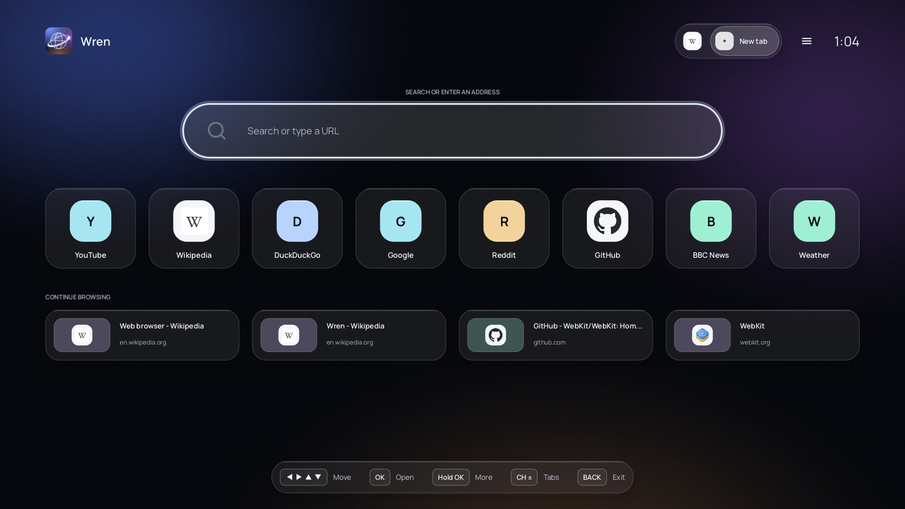
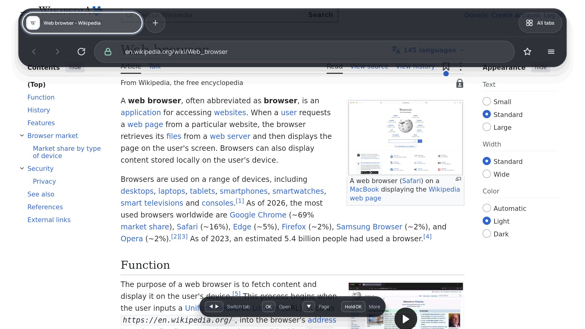
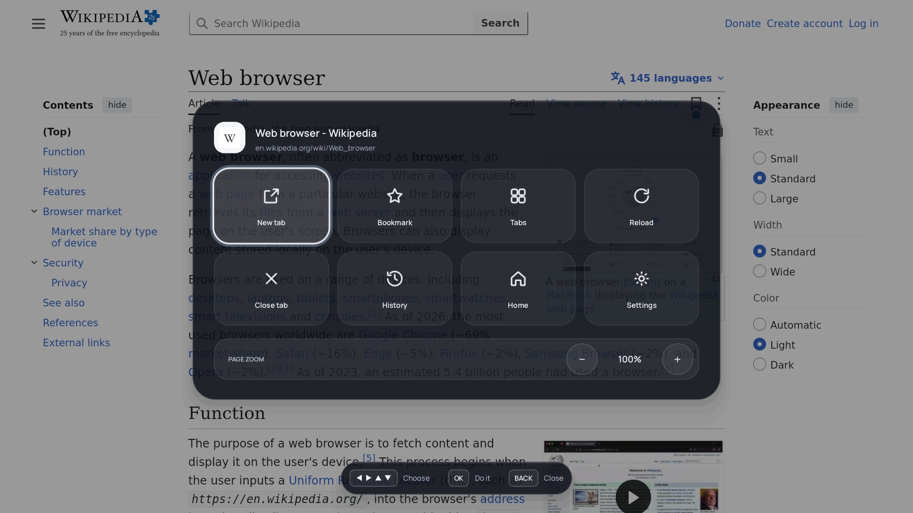
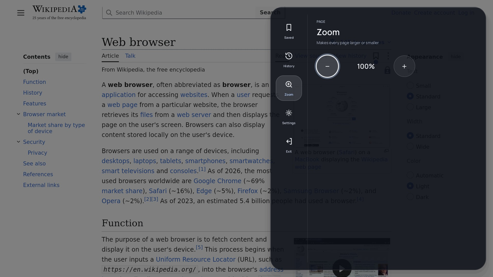

<p align="center"></p>

# Wren: a web browser for LG webOS TVs

A native web browser for LG TVs: **WPE WebKit 2.50** with a JavaScript JIT, GPU drawing, **hardware video through
LG's own media pipeline** and **Widevine DRM** on the TV's built-in CDM. Made for the sofa: everything works with
the arrows, OK and Back of any LG remote.

| | |
|---|---|
|  **Home**: search, shortcuts, recent pages, open tabs |  **Browsing**: ▲ at the top of a page shows the tabs and the toolbar |
|  **Hold OK**: quick actions and page zoom |  **Menu**: bookmarks, history, zoom, settings |

## Features

- Tabs, bookmarks, history, search engine choice, page zoom, "continue where you left off", sites' own icons
- Hardware video (H.264, HEVC, VP9; MSE, DASH, HLS) with HDR10/HLG, on LG's decoder
- Widevine DRM (EME) through the TV's own CDM
- Ad and tracker blocking (EasyList, EasyPrivacy), on by default; ads can be allowed per site from **Hold OK**
- YouTube opens as its fast TV app, full screen
- Remote-first: a slim toolbar above the page (**▲** at the top of a page goes to it), **Hold OK** for quick actions, **CH ±** to switch tabs; the
  Magic Remote pointer and colour keys work too ([all keys](docs/usage.md))

## Install

**webOS 5 or newer** should work (2020 TVs onwards, webOS 22–26 included); webOS 6 is tested, webOS 5 reported
working, webOS 3.4–4 experimental
([which TVs](docs/compatibility.md)). No root is needed to run it.

**From the Homebrew Channel** (updates show up there too): open **Settings → Repositories → Add repository** and
enter the [Native-Webos repository](https://github.com/Native-Webos/webos-apps-repo):

```
https://native-webos.github.io/webos-apps-repo/api/apps.json
```

Go back to the app list, refresh, open **Wren** and select **Install**. Wren appears there once its listing is
approved; until then, use the ipk.

**From the ipk:** download it from [Releases](../../releases) and install it with the Homebrew Channel's local
install or:

```sh
ares-install -d <your-device> org.sostk.wpebrowser_0.3.3_arm.ipk
```

Each release also carries `org.sostk.wpebrowser.manifest.json`, the Homebrew Channel manifest (version, ipk link
and SHA-256), at a fixed address for the latest release:
`https://github.com/sostk/webos-wpe-browser/releases/latest/download/org.sostk.wpebrowser.manifest.json`.

## Reporting a bug

Plug a USB drive into the TV, then in Wren: hold OK → **Settings** → **Help and feedback** → **Save logs to USB**.
Attach the `wren-logs-….txt` file to a [bug report](https://github.com/sostk/webos-wpe-browser/issues/new?template=bug_report.yml).
Logs are cleared when the TV restarts, so save them first.

## Limitations

- **Widevine runs at software security level**, so some services cap the quality or refuse to play.
- Wren uses the TV's own provisioned Widevine CDM. This is outside the terms LG and Google ship it under, and the
  TV's Widevine certificate could in principle be revoked. **Use at your own risk.**
- Opus and Vorbis audio is decoded in software; only one hardware video plays at a time.
- The ad blocker cannot stop YouTube's video ads, which come from the same servers as the videos. Its lists are
  updated with each Wren release.
- Cloudflare security checks ("Verifying you are human") take about a minute on a TV's processor. Wait for
  them; the site then remembers the pass for a while.

## More

[Documentation](docs/README.md): using the remote, launch parameters and logs, supported TVs, how it works,
building, patches. The development log is [NOTES.md](NOTES.md).

## Licence

GPL-3.0-or-later ([LICENSE](LICENSE)). Fonts: Manrope and Atkinson Hyperlegible (SIL OFL). Bundled libraries keep
their own licences ([details](docs/building.md#licences-in-the-package)). The ad blocker's lists are
[EasyList and EasyPrivacy](https://easylist.to) (GPL-3.0-or-later or CC BY-SA 3.0). Widevine is not included: Wren uses the
CDM already on the TV. Built with the [webOS native app kit](https://github.com/Native-Webos/webos-native-app-kit).
