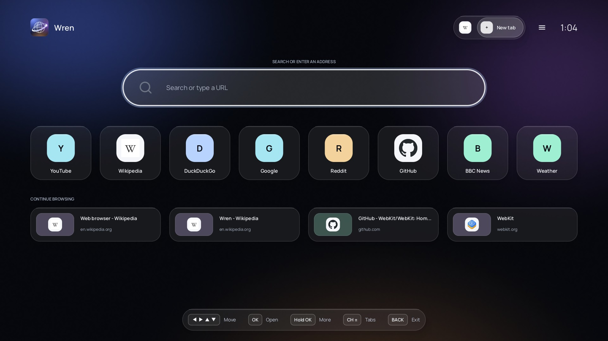
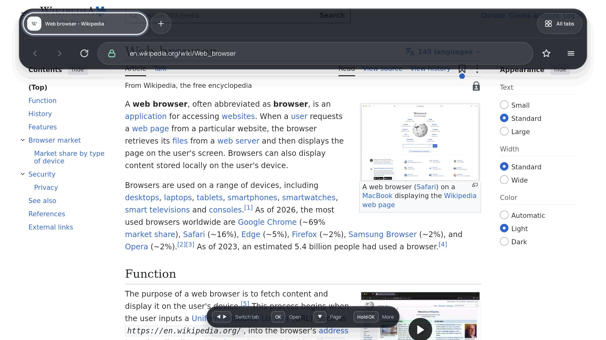
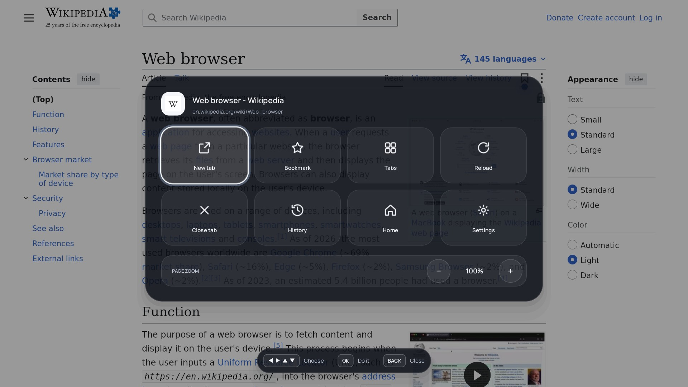
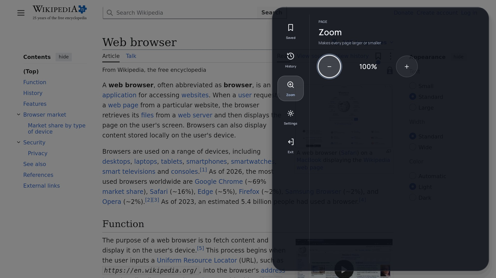
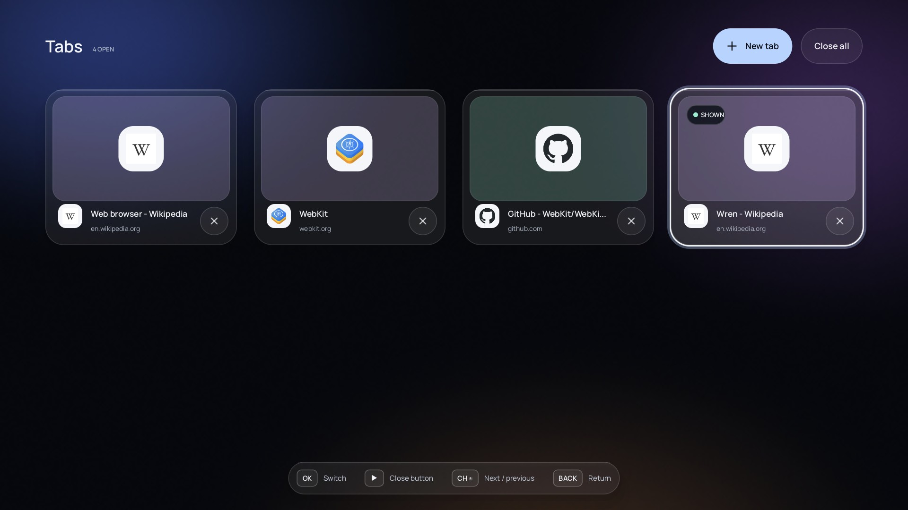

<p align="center"></p>

# Wren: a web browser for LG webOS TVs

A web browser for LG webOS TVs, built as a native app: **WPE WebKit 2.50.5** with a JavaScript JIT for the TV's
32-bit ARM, drawn by the TV's GPU, with **hardware video through LG's own media pipeline** and **Widevine DRM** on
the TV's built-in Widevine CDM. Its interface is made for the sofa: a dark glass look, large targets, and everything
reachable with the arrows, OK and Back of any LG remote. It is built with the
[webOS native app kit](https://github.com/Native-Webos/webos-native-app-kit).

App id `org.sostk.wpebrowser` (kept from its first name, WPE Browser, so updates install over it), version 0.3.0.
Developed and tested on an LG OLED65C1 (webOS 6.5.3, firmware 03.53.45). The support floor is webOS 6 (glibc 2.28).

## Screenshots

Captured on the TV (1920×1080).

| | |
|---|---|
|  **Home**: search, shortcuts, recent pages, open tabs |  **Browsing**: ▲ at the top of a page shows the tabs and the toolbar |
|  **Hold OK**: quick actions and page zoom |  **Menu**: bookmarks, history, zoom, settings |
|  **All tabs**, with the sites' own icons | |

## Features

- **Browser UI:** tabs, address bar with search (Google, Bing, DuckDuckGo, Ecosia, Startpage), a Home page with
  shortcuts and recent pages, bookmarks, history, page zoom, "continue where you left off", clearing browsing data,
  and settings. Sites show their own icons (from their icon links; WPE has no favicon API).
- **TV input, any LG remote:** D-pad navigation in pages (WebKit spatial navigation); ▲ at a page's top edge shows
  the glass panel with the tab row and toolbar (◀ ▶ + OK switch tabs); **Hold OK** opens quick actions; **CH ±**
  switches tabs; Back goes back, or to the panel. The Magic Remote pointer is a mouse and its wheel scrolls. Colour
  keys are optional shortcuts: Red all tabs, Green bookmarks, Yellow quick actions, Blue new tab.
- **Modern web engine:** WPE WebKit 2.50.5 (Skia), with the Baseline/DFG JIT running on webOS's softfp ABI
  (patch 0004). Pages are painted on the CPU and composited with the TV's Mali GPU straight to the screen.
- **Hardware video:** MSE and `<video>` (H.264, HEVC, VP9; AAC audio) are decoded by LG's media pipeline
  (`StarfishMediaAPIs`) on the TV's video plane, the same player LG's own Chromium uses. HDR10/HLG metadata,
  end of stream, seeks and resolution changes are handled the way LG's Chromium does them
  ([docs/lg-chromium-media.md](docs/lg-chromium-media.md)). DASH and HLS via Shaka, dash.js, hls.js or Video.js.
- **Widevine DRM (EME):** `drm/ocdm-widevine` implements the OpenCDM API on the Widevine CE CDM that ships on
  the TV (`libwidevine_ce_cdm_shared.so`), so WebKit's EME works for Widevine sites (tested: Shaka demo
  streams, a subscription live TV service). See [Limitations](#limitations).
- **Everything bundled:** the engine brings its own GLib, libsoup, GStreamer, ICU, fonts and TLS certificates;
  only the TV's glibc, GPU drivers and media/DRM libraries are used.

## Install

Download the ipk from the [Releases](../../releases) page and install it on the TV:

```sh
ares-install -d <your-device> org.sostk.wpebrowser_0.3.0_arm.ipk
```

(or with the Homebrew Channel's local install). The app runs as a normal app in the TV's app jail; it was
developed on a rooted TV, but needs no root at run time.

Launch parameters (`ares-launch -d <device> org.sostk.wpebrowser '<json>'`):

| Parameter | Effect |
|---|---|
| `{"target": "https://…"}` | open this URL |
| `{"wpebRenderer": "gpu" \| "software"}` | GPU (default) or software rendering (needs an engine built with `STAGE_MESA=1`) |
| `{"wpebPresent": "direct" \| "shm"}` | draw pages straight to the screen (default) or via shared memory |
| `{"wpebShow": "home" \| "panel" \| "quick" \| "side" \| "zoom" \| "tabs"}` | open that screen a few seconds after start (screenshots, tests) |
| `{"wpebEnv": {"NAME": "value"}}` | environment for the engine, e.g. `WPE_BROWSER_DEBUG_CONSOLE=1` (page console, EME/MSE calls and media events to `engine.log`), `GST_DEBUG`, `WEBKIT_*`, `WPEB_HW_OPUS=1` (experimental hardware Opus) |

Logs on the TV: `/tmp/org.sostk.wpebrowser/engine.log` (and `engine.prev.log`, the run before) and `events.log`.
They are cleared when the TV restarts.

**Reporting a bug:** plug a USB drive into the TV, then in Wren hold OK → **Settings** → **Help and feedback** →
**Save logs to USB**. That writes `wren-logs-<date>.txt` (all three logs, with query strings and fragments cut
from web addresses) to the drive. Attach it to a [bug report](https://github.com/sostk/webos-wpe-browser/issues/new?template=bug_report.yml).

## Limitations

- **Widevine runs at software security level.** Samples are decrypted by the CDM into normal memory and fed to
  the hardware decoder in the clear, so `HW_SECURE_*` robustness is not offered. Services that require hardware
  security, or licence servers that cap software clients, give SD or refuse; their webOS apps (LG's Chromium)
  get hardware security. Sending encrypted samples to LG's secure video path is undocumented and not attempted
  ([docs/lg-chromium-media.md](docs/lg-chromium-media.md) §4).
- Widevine use goes through the TV's own provisioned CDM; this is outside the terms LG and Google ship it under,
  and the TV's Widevine certificate could in principle be revoked. Use at your own risk.
- ClearKey does not work while the Widevine (Thunder) backend is on; persistent licences and
  `setServerCertificate` are not implemented.
- Audio other than AAC (Opus, Vorbis) is decoded in software and played through PulseAudio; WebM audio from
  MSE has a demuxer bug. A codec change mid-stream can stall.
- One hardware video at a time per app (LG's pipeline); a second one loses its picture.

## How it works

Two processes, because the UI and the engine need different toolchains:

1. **`browser/`, the UI app** (`org.sostk.wpebrowser`): C++ on the webOS native app kit, built with the stock
   webOS NDK. It owns the window, the browser chrome, input, and LG's media pipeline (which must run under the
   app's own process to get its media resources), and starts the engine.
2. **`engine/`, the engine** (`wpe-engine` + WebKit's `WPEWebProcess`/`WPENetworkProcess`): built with a
   GCC 14 / glibc 2.28 cross toolchain and Buildroot, because WebKit needs a far newer userland than the NDK's.
   It talks to the UI over a socket (`common/wpe_ipc.h`); pages are drawn by the GPU into a surface below the UI
   (`engine/webos-backend`, direct presentation), or sent as shared-memory frames.

Media: WebKit's GStreamer pipeline hands encoded video (and AAC) to the browser's own sinks
(`engine/gst/wpebmediasink.c`), which send them over `common/wpe_media_ipc.h` to the UI process, which feeds
LG's pipeline (`browser/media_server.cpp`, `browser/lg_media_player.cpp`). WebKit punches a hole in the page
where the video is.

## Repository layout

| Path | What |
|---|---|
| `browser/` | the UI app: `wren_ui.*` (the glass interface: Home, tab row, overlays), `chrome.*` (buttons, address bar), screens (settings, history, bookmarks), engine client, LG media player, profile, tests |
| `browser/branding/` | the Wren icon sources (SVG at three detail levels: 512 master, 130 and 80 px) |
| `engine/src/` | `wpe-engine`: WebKit views, settings, site quirks, debug console, IPC with the UI |
| `engine/gst/` | GStreamer sinks that send encoded audio/video to LG's pipeline |
| `engine/webos-backend/` | libwpe backend for direct GPU presentation on webOS (wl_webos foreign surfaces) |
| `common/` | the UI ↔ engine and media IPC protocols |
| `drm/ocdm-widevine/` | `libocdm.so`: OpenCDM on the TV's Widevine CE CDM ([docs/widevine-cdm-abi.md](docs/widevine-cdm-abi.md)) |
| `buildroot-external/` | Buildroot tree: configs (softfp, hard-float), the `ocdm-widevine` package, package patches |
| `toolchain/` | crosstool-ng configs (GCC 14.2, glibc 2.28, Linux 4.4 headers, `arm-webos-linux-gnueabi`) |
| `docker/` | the build container (`run.sh '<cmd>'`) |
| `third_party/webos-native-app-kit/` | the kit (submodule) and `third_party/patches/` (local kit patches) |
| `tools/` | build scripts, engine staging, on-TV probes and tests (`eme-test`, `media-tests`, …) |
| `docs/` | design notes: [webkit-like-chromium.md](docs/webkit-like-chromium.md), [widevine-cdm-abi.md](docs/widevine-cdm-abi.md), [lg-chromium-media.md](docs/lg-chromium-media.md) |
| `NOTES.md` | the full development log: decisions, TV findings, measurements |

## Patches

### WPE WebKit 2.50.5 (`buildroot-external/patches/wpewebkit/`)

| Patch | Why |
|---|---|
| `0001-honour-WEBKIT_EXEC_PATH-in-release-builds` | WebKit's helper processes ship inside the app package, not at the compile-time path |
| `0002-use-the-default-EGL-display-without-Mesa-surfaceless` | the TV's Mali EGL has no `EGL_MESA_platform_surfaceless`: use its default display with a surfaceless context or a 1×1 pbuffer |
| `0003-allow-grayscale-font-antialiasing` | WPE always used LCD subpixel antialiasing, which shows colour fringes on a TV panel |
| `0004-jsc-arm-softfp-jit` | JavaScriptCore's ARMv7 JIT on webOS's softfp ABI (V8's model: doubles in core registers only at C-call boundaries); without it JSC falls back to the slow interpreter |
| `0005-skia-arm32-gcc-raster-pipeline-abi` | Skia's `pcs("aapcs-vfp")` stage ABI mismatches under GCC softfp: gradients, masks and colour filters were drawn as stripes |
| `0006-wpe-optional-process-swap-on-navigation` | lets the browser keep a view in its web process (`WPE_BROWSER_NO_PROCESS_SWAP`): the webOS compositor can't move a view's layer between processes |
| `0007-gstreamer-ring-buffer-max-size-is-guint64` | an `int` passed for a `guint64` property through varargs crashed the web process on 32-bit ARM when setting up MSE video |
| `0008-jsc-32bit-gcc-no-speculative-indexing-header-loads` | GCC hoisted an `IndexingHeader` load above its type check; past a 1 MB heap chunk's end it faulted (SIGSEGV in `allocateMoreOutOfLineStorage`, [webkit.org/b/295780](https://bugs.webkit.org/show_bug.cgi?id=295780)) |

### GnuTLS (`buildroot-external/patches/gnutls/`)

| Patch | Why |
|---|---|
| `0001-use-the-app-CA-bundle-at-its-runtime-path` | read the app's packaged CA bundle (`WPE_BROWSER_CA_FILE`, via `secure_getenv`); verification is unchanged |

### webOS native app kit (`third_party/patches/webos-native-app-kit/`)

Applied on top of the submodule by `third_party/patches/apply-kit-patches.sh`; candidates for upstreaming.

| Patch | Why |
|---|---|
| `0001-Delegate-on_pointer-hook` | the app sees every pointer event first (the page under the Magic Remote pointer) |
| `0002-GLIBC_RUNTIMES-private-runtime-tree` | package a private runtime (the engine) that uses the TV's glibc, with its own package check |
| `0003-TextField-set_chromeless` | a text field without its own box, for the address-bar pill |
| `0004-Dialog-drop-down-menu-support` | dialog width, padding and top-right anchoring, for the browser menu |
| `0005-check-package-system-lib` | name further TV system libraries the private runtime may link |

## Build

Needs Docker, the webOS NDK (for the UI) and about 30 GB of disk; the first WebKit build takes a few hours.
Build outputs go to `~/webos-browser-build/` outside the repository.

```sh
git submodule update --init && third_party/patches/apply-kit-patches.sh
docker build -t webos-browser-build:1 docker/

# Engine: toolchain + Buildroot (WebKit with the softfp JIT; it also stages the engine once)
bash tools/build-softfp-jit.sh start          # detached; `status` shows progress

# Licences of the engine's packages, then (re)stage the engine with its libraries and licences
docker/run.sh 'make -C /build/buildroot O=/build/br-out BR2_EXTERNAL=/src/buildroot-external WPEB_SOFTFP_JIT=y legal-info'
docker/run.sh 'OUT=/src/build/engine-stage-jit/engine ENGINE_BUILD=/build/engine-build sh /src/tools/stage-engine.sh'

# UI app + engine → ipk
cd browser && ./build.sh webos                # build/webos-release/dist/org.sostk.wpebrowser_0.3.0_arm.ipk
```

`STAGE_MESA=1` bundles Mesa (software rendering, +30 MB), `STAGE_GST_TOOLS=1` the GStreamer command-line tools.
`./build.sh` alone builds and tests the UI on the desktop. See `NOTES.md` for the toolchain details.

## Licence

The app is GPL-3.0-or-later ([LICENSE](LICENSE)); its icons and logo are its own. Fonts: Manrope and Atkinson
Hyperlegible (SIL Open Font License; `browser/fonts/OFL-Manrope.txt`). The ipk bundles open-source libraries under
their own licences:
- the UI's (SDL, libwebp, libass, …): in the package's `licenses/` folder;
- the engine's (WebKit: LGPL-2.1+/BSD; GStreamer, GLib, libsoup, FFmpeg: LGPL; ICU, SQLite, and the rest of its
  Buildroot packages): in `engine/licenses/`, one folder per package with `manifest.csv` (package, version,
  licence, source). These come from Buildroot's `make … legal-info`, which `tools/stage-engine.sh` expects to
  have been run.

Widevine is not included: the app uses the CDM already on the TV.
